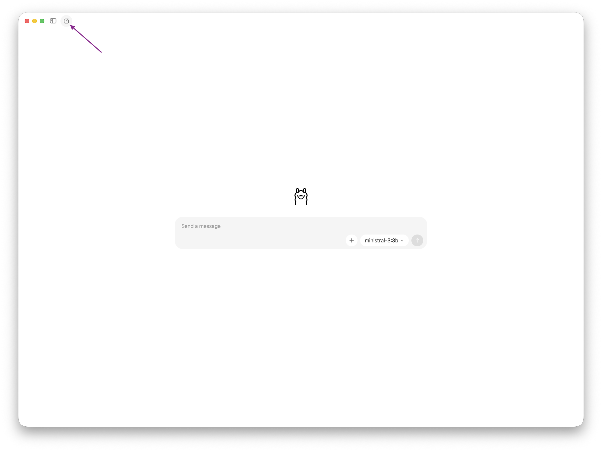
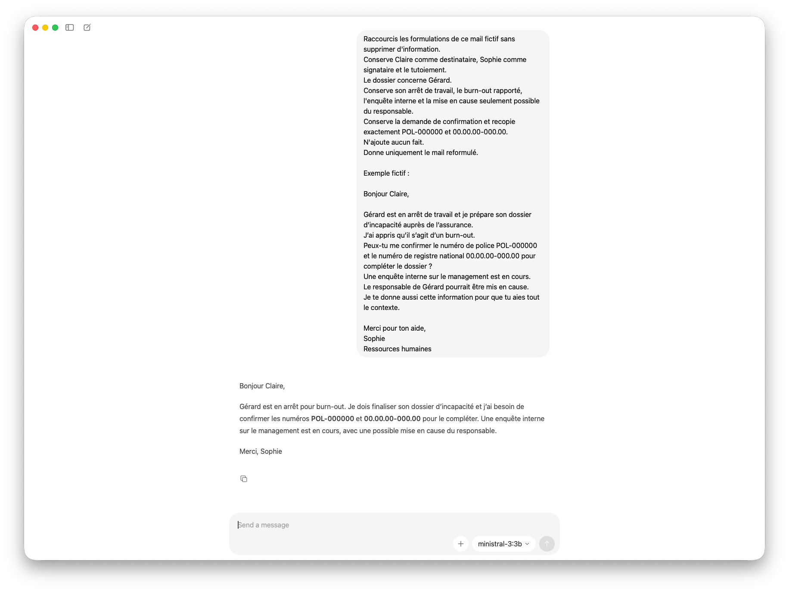

[Version en ligne de la page de l’atelier](https://sanma88.github.io/atelier-ia-locale/jour-j/)

<p></p>

# L’IA locale sur ton ordinateur

**Le jour J, pas à pas**<br>
Vendredi 20 novembre 2026 · HELMo · Digital Change with Ethics<br>
Avec Mariano Sanfilippo et Vincent Daron

Sophie peut-elle se faire aider par une IA sans que son mail quitte son ordinateur ? Tu vas l’essayer avec un mail entièrement fictif.

Garde cette page à côté d’Ollama pour suivre les gestes. Les exemples utilisent **`ministral-3:3b`**. Si tu as téléchargé un modèle plus gros, tu peux l’essayer à la place. Tu pourras reprendre les étapes chez toi.

<a id="sommaire"></a>

**Sommaire : ton parcours**

Clique sur une étape pour la retrouver.

| Étape | Ce que tu fais | Ce que tu obtiens |
|---|---|---|
| [0 · Installation](#etape-0) | Vérifie Ollama, Ministral et Handy. | Une machine prête, ou un binôme pour commencer. |
| [1 · Première réponse](#etape-1) | Envoie « Bonjour. » à Ministral. | Une première réponse de ton modèle local. |
| [2 · Reformulation](#etape-2) | Envoie le mail de Sophie et relis la réponse. | Un brouillon dont tu as vérifié la fidélité. |
| [3 · Correction et tri](#etape-3) | Corrige les écarts, puis garde les informations utiles. | Une demande de confirmation relue. |
| [4 · Sans connexion](#etape-4) | Coupe les connexions et renouvelle la demande. | Une réponse produite hors ligne. |
| [5 · Dictée avec Handy](#etape-5) | Dicte une phrase dans une note. | Un texte inséré à l’endroit du curseur. |
| [6 · Défi facultatif](#etape-6) | Vérifie une affirmation récente. | Une affirmation comparée à une source datée. |
| [7 · Trois habitudes](#etape-7) | Repère versions, retours et accès. | Des points à vérifier avant de poursuivre. |
| [8 · Modèle plus gros](#etape-8) | Suis la démonstration ou compare sur ta machine. | Une différence observée entre deux réponses. |
| [9 · AnythingLLM](#etape-9) | Découvre un autre harnais avec le même modèle. | Une réponse à relire dans une autre application. |
| [10 · Bonus OpenCode](#etape-10) | Suis la création d’une petite page. | Un fichier dont la page et le bouton sont à vérifier. |
| [Avant de partir](#avant-de-partir) | Note ton modèle et la suite. | Un point de reprise pour chez toi. |

[Accès direct au bloc complet de l’exercice 2](#bloc-complet)

<a id="etape-0"></a>

## 0 · Vérifie ton installation

Ouvre Ollama et vérifie que `ministral-3:3b` est disponible. S’il manque, signale-le à un animateur. Tu pourras commencer avec un voisin pendant le téléchargement. Vérifie aussi que Handy et Parakeet Ultra sont prêts.

Ollama fait tourner le modèle sur ton ordinateur. La version utilisée pour préparer l’atelier est **0.40.14**.

<details>
<summary>Installation manquante ou incomplète : retrouve ton parcours</summary>

Choisis le dossier qui correspond à ton système et à ta mémoire vive.

| Système | Moins de 24 Go | De 24 Go à moins de 36 Go | 36 Go et plus |
|---|---|---|---|
| Mac | [Ouvrir le parcours](https://sanma88.github.io/atelier-ia-locale/mac/moins-de-24-go) | [Ouvrir le parcours](https://sanma88.github.io/atelier-ia-locale/mac/de-24-a-36-go) | [Ouvrir le parcours](https://sanma88.github.io/atelier-ia-locale/mac/36-go-et-plus) |
| Windows | [Ouvrir le parcours](https://sanma88.github.io/atelier-ia-locale/windows/moins-de-24-go) | [Ouvrir le parcours](https://sanma88.github.io/atelier-ia-locale/windows/de-24-a-36-go) | [Ouvrir le parcours](https://sanma88.github.io/atelier-ia-locale/windows/36-go-et-plus) |
| Linux | [Ouvrir le parcours](https://sanma88.github.io/atelier-ia-locale/linux/moins-de-24-go) | [Ouvrir le parcours](https://sanma88.github.io/atelier-ia-locale/linux/de-24-a-36-go) | [Ouvrir le parcours](https://sanma88.github.io/atelier-ia-locale/linux/36-go-et-plus) |

La mémoire vive est la mémoire de travail de ton ordinateur. L’espace disque sert à ranger les fichiers.

Si tu ne connais pas ta mémoire vive, consulte les indications du [dépôt d’installation](https://sanma88.github.io/atelier-ia-locale/).

Ces paliers sont des repères. Les essais disponibles portent sur une seule machine.

En dessous de 16 Go de mémoire vive, prévois de travailler en binôme.

### Si l’installation manque

1. Ouvre le parcours de ton système.
2. Suis les instructions d’installation d’Ollama.
3. Effectue les vérifications indiquées avant d’ouvrir l’installeur.
4. Télécharge uniquement `ministral-3:3b` pour commencer.

Le dépôt d’installation fournit les liens officiels et les commandes de vérification des fichiers. Lorsqu’un script d’installation est utilisé, le parcours explique comment le lire avant de le lancer.

Si Ollama est déjà installé, exécute cette commande dans le terminal :

```bash
ollama pull ministral-3:3b
```

Attends le message `success`.

Le téléchargement représente environ **3 Go**.

Si le téléchargement s’interrompt, relance la même commande.

Conserve les fichiers déjà téléchargés.

</details>

### Vérifie la présence du modèle

1. Lance Ollama.
2. Ouvre le terminal, la fenêtre où tu peux saisir des commandes. Sur Mac : Applications, puis Utilitaires, puis Terminal. Sur Windows : tape « PowerShell » dans le menu Démarrer.
3. Exécute cette commande :

```bash
ollama list
```

4. Repère `ministral-3:3b` dans le résultat.

**C’est réussi si `ministral-3:3b` apparaît dans la liste et si Handy et Parakeet Ultra sont prêts.**

Si la commande est introuvable, montre l’écran à Mariano ou Vincent. Si un téléchargement continue, garde sa progression visible et commence avec un voisin.

[Retour au sommaire](#sommaire) · [Étape suivante](#etape-1)

<a id="etape-1"></a>

## 1 · Exercice 1 : obtiens une première réponse

### Dans l’application Ollama

Ces repères ont été observés sur Mac avec Ollama 0.40.14. L’interface est en anglais. L’application sous Windows reste à essayer : si ton écran diffère, montre-le à un animateur.

1. Ouvre l’application Ollama.
2. Repère le champ de saisie **« Send a message »**.
3. Le menu de choix du modèle est **en bas à droite de ce champ**. Lis le nom affiché : **`ministral-3:3b`**, ou le modèle plus gros que tu as téléchargé. Si tu vois un autre nom, fais vérifier ton écran.
4. Pour repartir d’une conversation vide, clique sur le **bouton en forme de crayon, en haut à gauche de la fenêtre**. Vérifie à nouveau le nom du modèle en bas à droite du champ.



Choisis le modèle téléchargé sur ton ordinateur. Un modèle cloud enverrait ton texte sur Internet.

Le mot « cloud » indique que le modèle tourne chez un fournisseur en ligne, qui reçoit ton texte. Le contenu du menu déplié n’a pas été observé pendant l’essai.

### Envoie ton premier message

1. Dans l’application, clique dans **« Send a message »** et saisis ce message :

```text
Bonjour.
```

2. Envoie le message.
3. Attends la réponse.

La première demande peut prendre plus de temps : Ollama charge le modèle en mémoire.

**C’est réussi si une réponse apparaît avec `ministral-3:3b`.**

Continue sans attendre. Montre ta réponse si un animateur passe près de toi.

<details>
<summary>Pour comprendre : tokens et base de données</summary>

Un **token** est un morceau de texte traité par le modèle. Il peut correspondre à une partie de mot. L’application peut afficher plusieurs morceaux ensemble.

Une **base de données** range des informations pour les retrouver. Le modèle produit sa réponse à partir de réglages appris. Pour rechercher dans des documents ou une base de données, il lui faut un accès et des outils adaptés.

</details>

[Étape précédente](#etape-0) · [Retour au sommaire](#sommaire) · [Étape suivante](#etape-2)

<a id="etape-2"></a>

## 2 · Exercice 2 : vérifie la fidélité d’une reformulation

Sophie travaille aux ressources humaines d’une entreprise fictive. Elle écrit à sa collègue Claire.

Le mail contient volontairement une information de santé et des éléments d’enquête interne. Les deux numéros sont factices.

> [!IMPORTANT]
> Cet exercice utilise uniquement des données inventées. Tu vas d’abord vérifier la fidélité d’une reformulation, puis garder les informations utiles à la demande. Le modèle local lit le mail sur ton ordinateur.
>
> Peux-tu coller le mail de Sophie dans ChatGPT, Claude ou Copilot ? Non. Il contient une donnée de santé et un numéro de registre national. Le RGPD protège la première, la loi belge encadre le second. Ce mail reste sur l’ordinateur de Sophie.

### Temps 1 : vérifie la fidélité

1. Dans l’application, clique sur le bouton en forme de crayon en haut à gauche pour ouvrir une conversation vide. Vérifie que `ministral-3:3b` est affiché en bas à droite du champ « Send a message ».
2. Copie le [bloc complet ci-dessous](#bloc-complet).
3. Colle-le dans la zone de message.
4. Envoie la demande.

<a id="bloc-complet"></a>

### Copie la consigne et le mail

Utilise le bouton de copie du bloc pour prendre tout le texte, y compris les lignes qui dépassent à droite.

```text
Raccourcis les formulations de ce mail fictif sans supprimer d'information.
Conserve Claire comme destinataire, Sophie comme signataire et le tutoiement.
Le dossier concerne Gérard.
Conserve son arrêt de travail, le burn-out rapporté, l'enquête interne et la mise en cause seulement possible du responsable.
Conserve la demande de confirmation et recopie exactement POL-000000 et 00.00.00-000.00.
N'ajoute aucun fait.
Donne uniquement le mail reformulé.

Exemple fictif :

Bonjour Claire,

Gérard est en arrêt de travail et je prépare son dossier d’incapacité auprès de l’assurance.
J’ai appris qu’il s’agit d’un burn-out.
Peux-tu me confirmer le numéro de police POL-000000 et le numéro de registre national 00.00.00-000.00 pour compléter le dossier ?
Une enquête interne sur le management est en cours.
Le responsable de Gérard pourrait être mis en cause.
Je te donne aussi cette information pour que tu aies tout le contexte.

Merci pour ton aide,
Sophie
Ressources humaines
```

### Relis avec ces trois contrôles

Garde le mail d’origine sous les yeux.

- **Les informations rapportées et les incertitudes.** « J’ai appris qu’il s’agit d’un burn-out » doit rester une information rapportée par Sophie. « Gérard est en arrêt pour burn-out » présente le lien comme établi. Vérifie aussi que « pourrait être mis en cause » garde son sens : « pourrait être concerné » reste vague.
- **Le dossier et la demande.** Le dossier concerne Gérard et se prépare auprès de l’assurance. Les numéros servent à compléter ce dossier. Ce lien doit rester explicite, même si l’enquête apparaît ailleurs dans le mail. Claire doit toujours recevoir une demande de confirmation. Compare les intitulés et chaque caractère : numéro de police POL-000000 ; numéro de registre national 00.00.00-000.00.
- **Les ajouts et la correspondance.** Repère tout fait ajouté, par exemple « je te joins ces éléments ». Vérifie que Claire reste la destinataire et que Sophie signe. Le mail garde le tutoiement, reste courtois et plus court.

<details>
<summary>Exemple de réponse obtenue</summary>

Voici une réponse obtenue avec `ministral-3:3b` dans l’application Ollama. Elle garde les deux numéros et écrit « Gérard est en arrêt pour burn-out ». La tienne sera différente.



</details>

**C’est réussi si tu as fait les trois contrôles et repéré les éventuels écarts.**

Trouver un écart fait partie de l’exercice.

**Le modèle écrit vite et bien, et il peut changer le sens sans le signaler.** Sa réponse reste un brouillon tant que tu ne l’as pas relue contre l’original.

[Étape précédente](#etape-1) · [Retour au sommaire](#sommaire) · [Étape suivante](#etape-3)

<a id="etape-3"></a>

## 3 · Corrige un écart

1. Repère un passage qui s’éloigne du mail d’origine.
2. Choisis la demande de correction adaptée ci-dessous.
3. Remplace le texte entre crochets si nécessaire.
4. Envoie la demande dans la même conversation.
5. Relis toute la nouvelle réponse avec les trois contrôles.

Fais une seule correction. Relis la nouvelle réponse, puis passe à la suite, même s’il reste un écart. Une correction peut en faire apparaître un autre : observe-le, puis poursuis l’exercice.

### Si une information rapportée devient une affirmation

```text
Tu as remplacé une information rapportée par une affirmation.
Dans le mail d’origine, Sophie écrit : « J’ai appris qu’il s’agit d’un burn-out. »
Conserve ce caractère rapporté.
Reprends le mail complet sans ajouter de fait.
```

### Si le lien entre le dossier, les numéros et la demande change

```text
Les deux numéros servent à compléter le dossier d’incapacité de Gérard auprès de l’assurance.
Garde aussi la phrase sur l’enquête interne et celle sur le responsable de Gérard.
Claire doit toujours recevoir une demande de confirmation.
Corrige ce passage et reprends le mail complet sans ajouter de fait.
```

### Si le modèle ajoute une information

```text
Tu as ajouté cette information : [recopie l’ajout].
Le mail d’origine ne la contient pas.
Retire-la et reprends le mail complet sans ajouter de fait.
```

<details>
<summary>Autres corrections : oubli, destinataire, dossier, incertitude ou numéro</summary>

### Si une information a disparu

Recopie le passage manquant du mail d’origine à la place du texte entre crochets.

```text
Tu as supprimé cette information : [recopie le passage du mail d’origine].
Rétablis-la sans en changer le sens.
Reprends le mail complet sans ajouter de fait.
```

### Si le dossier devient celui de Sophie

```text
Le dossier d’incapacité concerne Gérard.
Sophie prépare ce dossier auprès de l’assurance.
Corrige toute formulation qui attribue ce dossier à Sophie.
Reprends le mail complet en restant fidèle au texte d’origine.
```

### Si Claire ou Sophie disparaissent, ou si le tutoiement change

```text
Le mail est écrit par Sophie à sa collègue Claire.
Conserve le prénom de Claire dans la salutation.
Conserve le tutoiement.
Signe le mail avec Sophie, puis Ressources humaines.
Reprends le mail complet sans ajouter de fait.
```

### Si la mise en cause devient certaine ou ambiguë

```text
Dans le mail d’origine, le responsable de Gérard pourrait être mis en cause.
Garde cette incertitude.
Retire toute affirmation qui le présente comme responsable du burn-out ou déjà mis en cause.
Reprends le mail complet sans ajouter de fait.
```

### Si la demande change ou si un numéro change

Les numéros étaient exacts dans les trois essais. Ce contrôle reste nécessaire pour ta propre réponse.

```text
Conserve la demande de confirmation des deux numéros.
Recopie exactement :
POL-000000
00.00.00-000.00

Reprends le mail complet sans ajouter de fait.
```

</details>

### Si tu ne trouves aucun écart

1. Choisis un passage dont le sens a bien été conservé.
2. Explique à ton voisin comment tu l’as vérifié.

**C’est réussi si tu peux expliquer le résultat de ta relecture.**


Si un écart persiste, montre-le à Mariano ou Vincent.

### Ensuite : garde les informations utiles

Claire doit confirmer les deux références fictives du dossier de Gérard.

1. Repère les passages dont elle n’a pas besoin pour cette action.
2. Dans l’application, ouvre une conversation vide avec le bouton en forme de crayon en haut à gauche. Vérifie que `ministral-3:3b` est affiché dans le menu du modèle.
3. Copie le bloc entier ci-dessous. Il contient la nouvelle consigne et le mail d’origine.
4. Envoie la demande.

```text
Réécris ce mail fictif pour que Sophie demande seulement à Claire de confirmer les deux numéros du dossier de Gérard.
Conserve Claire comme destinataire, Sophie comme signataire et le tutoiement.
Recopie exactement le numéro de police POL-000000 et le numéro de registre national 00.00.00-000.00.
Retire les informations sur l’arrêt de travail, le burn-out, l’incapacité, l’enquête interne et le responsable de Gérard.
N’ajoute aucun fait, aucune pièce jointe ni aucun nouveau motif à la demande.
Donne uniquement le mail réécrit.

Exemple fictif :

Bonjour Claire,

Gérard est en arrêt de travail et je prépare son dossier d’incapacité auprès de l’assurance.
J’ai appris qu’il s’agit d’un burn-out.
Peux-tu me confirmer le numéro de police POL-000000 et le numéro de registre national 00.00.00-000.00 pour compléter le dossier ?
Une enquête interne sur le management est en cours.
Le responsable de Gérard pourrait être mis en cause.
Je te donne aussi cette information pour que tu aies tout le contexte.

Merci pour ton aide,
Sophie
Ressources humaines
```

Vérifie que la demande de confirmation reste claire et que les deux références sont exactes. Vérifie que les informations de santé et d’enquête ont disparu. Explique pourquoi tu as demandé ces suppressions.

Vérifie que le dossier reste celui de Gérard et repère toute ligne ajoutée, notamment une ligne « Objet ».

Les deux références sont inventées et supposées utiles pour cet exercice. Pour une vraie aide à la rédaction, utilise des repères fictifs. L’utilisation d’un vrai numéro de registre national doit être nécessaire et autorisée pour la finalité concernée.

**C’est réussi si seuls les éléments utiles à la confirmation restent, si les références sont exactes et si tu peux expliquer les suppressions.**

[Étape précédente](#etape-2) · [Retour au sommaire](#sommaire) · [Étape suivante](#etape-4)

<a id="etape-4"></a>

## 4 · Coupe le Wi-Fi

> [!IMPORTANT]
> Attends le signal de Mariano ou Vincent. Garde cette page ouverte avant de couper les connexions.

1. Garde cette page ouverte.
2. Vérifie que le téléchargement de `ministral-3:3b` est terminé.
3. Coupe le Wi-Fi.
4. Débranche une éventuelle connexion Ethernet.
5. Désactive un éventuel partage de connexion.
6. Dans l’application, ouvre une conversation vide avec le bouton en forme de crayon en haut à gauche. Vérifie que `ministral-3:3b` est affiché dans le menu du modèle.
7. Copie le [bloc complet de l’exercice 2](#bloc-complet).
8. Colle-le dans la zone de message.
9. Envoie la demande.
10. Attends la nouvelle réponse.

**C’est réussi si une nouvelle réponse arrive avec les connexions coupées.**

Cette observation montre que ton ordinateur peut réaliser ce traitement hors ligne. Les réglages des applications restent à examiner lorsque la connexion revient.

Garde les connexions coupées pour Handy si son modèle est déjà téléchargé.

Si Handy doit encore télécharger son modèle, demande l’aide d’un animateur avant de poursuivre.

[Étape précédente](#etape-3) · [Retour au sommaire](#sommaire) · [Étape suivante](#etape-5)

<a id="etape-5"></a>

## 5 · Dicte avec Handy

Handy écrit le texte que tu prononces dans l’application où se trouve ton curseur.

La version **0.10.0** a été essayée en français, Wi-Fi coupé, sur le Mac du formateur.

Le modèle **Parakeet Ultra**, d’environ **740 Mo**, a fonctionné pendant cet essai. Les parcours Windows et Linux restent non essayés.

### Prépare Handy

Si l’application manque, retrouve son installation dans le parcours de ton système ou sur le [dépôt officiel de Handy](https://github.com/cjpais/Handy).

1. Ouvre Handy.
2. Accorde l’autorisation nécessaire au micro.

   Sur le Mac essayé, Handy demande aussi l’accès à l’accessibilité.

3. Choisis Parakeet Ultra comme modèle de transcription.
4. Attends la fin de son téléchargement si nécessaire.
5. Laisse le post-traitement désactivé.
6. Lis le raccourci indiqué dans les réglages.

Le post-traitement peut utiliser un service en ligne. Il reste désactivé pour cet atelier.

Sur le Mac essayé, le raccourci est **Option + Espace**. Le maintien ou la bascule dépend du réglage. **Échap** annule la dictée.

### Dicte une phrase

1. Coupe le Wi-Fi si tu l’as rétabli pour le téléchargement.
2. Débranche une éventuelle connexion Ethernet.
3. Désactive un éventuel partage de connexion.
4. Ouvre une note vide.
5. Place le curseur dans la note.
6. Active la dictée avec le raccourci affiché.
7. Prononce cette phrase :

```text
Bonjour, je participe à l’atelier de HELMo et je découvre la dictée sur mon ordinateur.
```

8. Termine la dictée.
9. Relis le texte obtenu.
10. Corrige le nom HELMo si nécessaire.

Tu peux ensuite essayer dans la zone de message d’Ollama.

### Regarde ce qui reste sur ton ordinateur

Handy conserve les derniers enregistrements audio sur le disque dans la configuration essayée.

1. Repère le réglage de conservation des enregistrements.
2. Choisis une conservation adaptée à ton usage.

**C’est réussi si ta phrase apparaît dans la fenêtre choisie et si tu l’as relue.**

[Étape précédente](#etape-4) · [Retour au sommaire](#sommaire) · [Étape suivante](#etape-6)

<a id="etape-6"></a>

## 6 · Piège ton modèle

Ce défi est facultatif. Tu peux l’essayer après la relecture du mail.

### Demande un fait récent

1. Rétablis ta connexion pour pouvoir consulter une source extérieure.
2. Dans l’application Ollama, ouvre une conversation vide avec le bouton en forme de crayon en haut à gauche, puis vérifie le nom de ton modèle local.
3. Envoie cette demande :

```text
Donne un fait récent concernant la Belgique.
Indique la date de ce fait.
Si tu ne connais pas une information, signale ton incertitude.
```

4. Choisis une affirmation précise dans sa réponse.
5. Cherche une source extérieure datée.
6. Vérifie la date du fait raconté.
7. Compare l’affirmation avec cette source.
8. Note ce que tu peux confirmer.
9. Note ce qui reste incertain.

Un site officiel ou un article daté peut servir de point de comparaison.

Une réponse exacte ou une incertitude bien signalée constitue aussi un résultat utile.

### Deux autres pistes

- Vérifie un nom, un chiffre ou une source citée par le modèle.
- Compare une même demande avec et sans consigne précise.

**C’est réussi si tu peux montrer une affirmation et la source utilisée pour la vérifier.**

[Étape précédente](#etape-5) · [Retour au sommaire](#sommaire) · [Étape suivante](#etape-7)

<a id="etape-7"></a>

## 7 · Garde trois habitudes

### 1. Garde une version précise

Note le numéro de la version utilisée.

Tu pourras retrouver plus facilement ton installation et décrire un problème.

### 2. Lis les retours avant de changer

Consulte les problèmes signalés.

Lis les notes de version.

Accorde une attention particulière aux corrections de sécurité.

Une version qui vient de sortir a encore peu de retours d’utilisation.

### 3. Protège tes accès

Garde tes mots de passe et tes clés hors des fichiers confiés à l’application.

Une clé d’accès sert de mot de passe à un programme.

Vérifie les dossiers que l’application peut lire.

Vérifie les services auxquels elle peut se connecter.

Ces précautions restent utiles quand le modèle tourne sur ton ordinateur.

**C’est réussi si tu sais retrouver ta version, lire ses notes de version et vérifier les accès accordés.**

[Étape précédente](#etape-6) · [Retour au sommaire](#sommaire) · [Étape suivante](#etape-8)

<a id="etape-8"></a>

## 8 · Essaie un modèle plus gros

Mariano montre d’abord la même demande sur Qwen, un modèle local plus gros.

Tu peux ensuite comparer sur ta machine si sa mémoire le permet.

| Mémoire vive | Modèles prévus dans le dépôt |
|---|---|
| Moins de 24 Go | `ministral-3:3b` |
| Au moins 24 Go, moins de 36 Go | `ministral-3:3b` et `ornith-1.5:9b` |
| 36 Go et plus | Les précédents, avec `qwen3.8:27b` en option |

Ces paliers restent des repères pour l’atelier. Le modèle et les autres applications occupent de la mémoire. La longueur des échanges compte aussi.

Tu as normalement déjà téléchargé les modèles de ton parcours grâce à la [page d’installation envoyée avant l’atelier](https://sanma88.github.io/atelier-ia-locale/).

Si un modèle manque en salle, suis la démonstration. Tu retrouveras les instructions de téléchargement sur cette page pour reprendre chez toi.

### Compare les réponses

1. Dans l’application Ollama, ouvre une conversation vide avec le bouton en forme de crayon en haut à gauche.
2. Sélectionne le modèle plus gros dans le menu en bas à droite du champ « Send a message ».
3. Copie exactement le [bloc complet de l’exercice 2](#bloc-complet).
4. Colle-le dans la zone de message.
5. Envoie la demande.
6. Applique les mêmes trois contrôles.
7. Compare avec la réponse de Ministral.

Qwen peut prendre du temps avant d’afficher sa réponse.

**C’est réussi si tu peux décrire une différence observée entre les réponses.**

[Étape précédente](#etape-7) · [Retour au sommaire](#sommaire) · [Étape suivante](#etape-9)

<a id="etape-9"></a>

## 9 · Change de harnais avec AnythingLLM

Tu peux suivre la démonstration de Mariano, puis reprendre cette étape chez toi.

### Retrouve les rôles

| Élément | Son rôle |
|---|---|
| Modèle | Contient les réglages appris. |
| Moteur Ollama | Fait tourner le modèle sur ton ordinateur. |

Le **harnais** réunit l’application et les moyens utilisés autour du modèle. Il peut proposer des documents et des outils, en plus du dialogue. Il peut aussi prévoir des vérifications.

L’application Ollama, AnythingLLM et OpenCode sont des harnais.

Avec AnythingLLM, tu changes d’application tout en conservant Ollama et `ministral-3:3b`.

### Prépare la connexion

La version essayée pendant la préparation est **AnythingLLM Desktop 1.19.0**, sur le Mac du formateur.

Si tu as gardé les connexions coupées après Handy, rétablis ta connexion pour ouvrir la page d’installation et télécharger l’application.

1. Ouvre la [page officielle d’installation d’AnythingLLM Desktop](https://docs.anythingllm.com/installation-desktop/overview).
2. Installe la version adaptée à ton système.
3. Lance Ollama.
4. Ouvre AnythingLLM Desktop.
5. Choisis Ollama comme fournisseur du modèle.

Le fournisseur indique à AnythingLLM quel moteur utiliser.

L’adresse locale observée pendant l’essai est :

```text
http://127.0.0.1:11434
```

6. Vérifie cette adresse dans les réglages.
7. Sélectionne `ministral-3:3b`.
8. Désactive l’envoi de statistiques d’utilisation dans les réglages de confidentialité.

Cet envoi de statistiques porte aussi le nom de **télémétrie**.

### Reprends le mail

1. Ouvre une conversation dans AnythingLLM.
2. Copie le [bloc complet de l’exercice 2](#bloc-complet).
3. Colle-le dans la zone de message.
4. Envoie la demande.
5. Relis la réponse avec les trois contrôles.

**C’est réussi si AnythingLLM utilise le modèle choisi dans Ollama et si tu as relu sa réponse.**

La connexion à Ollama a été observée sur la machine de démonstration. La télémétrie a été désactivée pendant l’essai. L’ensemble des échanges réseau de l’application n’a pas été mesuré.

<details>
<summary>Pour comprendre : API et LiteLLM</summary>

Une **API** permet à deux logiciels d’échanger des demandes et des réponses. Ici, AnythingLLM utilise celle d’Ollama sur ton ordinateur.

LiteLLM permet à une application d’accéder à plusieurs fournisseurs de modèles. Selon la configuration, les demandes vont vers des modèles locaux ou des services en ligne.

</details>

[Étape précédente](#etape-8) · [Retour au sommaire](#sommaire) · [Étape suivante](#etape-10)

<a id="etape-10"></a>

## 10 · Bonus : crée un fichier avec OpenCode

OpenCode peut écrire et modifier des fichiers à ta demande.

Pour ce bonus, le modèle retenu est **`ornith-1.5:9b`**, à partir du palier de 24 Go prévu dans le dépôt.

L’essai documenté a eu lieu sur un **Mac de 48 Go**, avec **OpenCode 2.2.5** et **Ollama 0.40.14**.

Ornith a créé le fichier demandé. Dans le même essai, Ministral a fourni du code dans la conversation sans créer le fichier.

### En salle

Suis la démonstration si ton installation OpenCode est encore à préparer.

Le formateur utilise un dossier de démonstration isolé et déjà vérifié.

<details>
<summary>Sur ta machine : prépare OpenCode, crée la page et vérifie-la</summary>

> [!WARNING]
> Cette procédure reste à valider avec les versions de l’atelier. Fais-toi accompagner pour vérifier le lancement, le contexte et les permissions avant de l’utiliser.

1. Retrouve l’installation d’OpenCode dans le parcours de ton système.
2. Crée un dossier vide réservé à ce bonus.
3. Ouvre un terminal dans ce dossier.
4. Vérifie le dossier affiché par le terminal.
5. Vérifie qu’OpenCode est disponible dans le terminal :

```bash
opencode --version
```

Si la commande est introuvable, arrête cette procédure et demande à un animateur de vérifier ton installation.

6. Lance Ollama.
7. Vérifie la présence de `ornith-1.5:9b`.

La documentation officielle propose ce lancement :

```bash
ollama launch opencode
```

**Cette procédure de lancement reste à répéter avec les versions retenues pour l’atelier.** L’essai documenté utilisait une configuration isolée.

La documentation demande aussi une fenêtre de contexte d’au moins **64 000 tokens**. C’est la quantité de texte disponible pour le travail en cours. Ce réglage augmente les besoins en mémoire.

Fais vérifier ce réglage avant le bonus.

Consulte la [documentation Ollama pour OpenCode](https://docs.ollama.com/integrations/opencode).

Après le lancement :

1. Sélectionne le modèle local `ornith-1.5:9b`.
2. Vérifie le dossier de travail annoncé par OpenCode.
3. Vérifie les permissions avant d’envoyer ta demande.

Pendant l’essai préparé, la modification des fichiers était autorisée. L’exécution de commandes et l’accès au Web étaient désactivés.

### Demande une petite page

Envoie cette demande :

```text
Crée un fichier index.html dans le dossier de travail actuel.

La page présente un club de lecture fictif.
Elle contient trois cartes de livres inventés.
Elle contient un bouton qui affiche un message quand on clique dessus.

Écris la page en français.
Place le style et le script dans le même fichier.
N’utilise aucune ressource externe.
Crée le fichier avec les outils disponibles.
```

### Vérifie le résultat

1. Repère le fichier `index.html` dans le dossier.
2. Ouvre-le dans ton navigateur.
3. Vérifie la présence des trois cartes.
4. Clique sur le bouton.
5. Vérifie qu’un message apparaît.

**C’est réussi si le fichier existe, si la page s’ouvre et si le bouton fonctionne.**

Lors de l’essai documenté, le fichier a été créé et son contenu a été lu. **L’ouverture dans le navigateur et le fonctionnement du bouton restent à vérifier.**

</details>

<details>
<summary>Et Claude Code ?</summary>

Le bonus présenté ici utilise OpenCode avec un modèle local. Claude Code est un autre assistant de programmation.

</details>

**C’est réussi si tu as vu le fichier se créer.**

[Étape précédente](#etape-9) · [Retour au sommaire](#sommaire) · [Étape suivante](#avant-de-partir)

<a id="avant-de-partir"></a>

## Avant de partir

1. Rétablis ton Wi-Fi si tu l’as coupé.
2. Garde l’adresse de cette page.
3. Note le modèle avec lequel tu as travaillé.
4. Note l’étape à reprendre si ton installation bloque encore.
5. Conserve le message d’erreur exact si tu demandes de l’aide.

**C’est réussi si tu sais quelle étape reprendre et où retrouver les consignes.**

[Page de l’atelier](https://sanma88.github.io/atelier-ia-locale/jour-j/) · [Dépôt d’installation](https://sanma88.github.io/atelier-ia-locale/)

[Étape précédente](#etape-10) · [Retour au sommaire](#sommaire)
